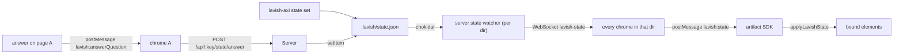

# Shared state

Several static pages in one directory often describe the same things: a PR, a Jira ticket, a worker, a question put to the reader. When each page bakes its own copy, updating one leaves every other page and every other tab wrong. Shared state gives each directory one store, renders every bound element from it, and pushes every change to the open pages live.

## The store

`<pagesDir>/.lavish/state.json`, one per directory of artifacts:

```json
{
  "version": 1,
  "staleAfterHours": 24,
  "items": {
    "pr:acme/app#123": {
      "status": "merged",
      "title": "Lock fix",
      "url": "https://github.com/acme/app/pull/123",
      "updatedAt": "2026-10-14T15:00:00Z",
      "source": "github"
    }
  }
}
```

- Item ids: `pr:<owner>/<repo>#<n>`, `ticket:<KEY>`, `worker:<name>`, `q:<question-id>`.
- Each item is a flat string map. `updatedAt` (ISO UTC) and `source` (`github`, `jira`, `captain`, or a page file name such as `index.html`) are reserved; every other key is a free field.
- Status vocabulary: pr `open|draft|merged|closed` plus an optional `review` of `needs-you|re-review|approved|changes-requested|none`; ticket uses the Jira status name verbatim; worker `running|idle|done|blocked|gone`; q `open|answered` plus `answer` and `answeredAt`.
- Reads are lenient (a number becomes a string, a malformed item is dropped); a file that is not JSON is an error, never an empty store.
- Writes take a lock directory beside the file, merge, stamp `updatedAt` and `source`, and replace the file with a rename, so a reader never sees half a file and two writers never lose each other's update.

## Writing it

```sh
lavish-axi state set "pr:acme/app#123" status=merged review=none --source github [--dir <pagesDir>]
lavish-axi state get "pr:acme/app#123" [--dir <pagesDir>]
lavish-axi state list [--dir <pagesDir>]
```

`--dir` defaults to the current directory and `--source` to `captain`. The CLI writes the file directly, so it works with or without a running server.

A page writes exactly one thing: the answer to a question (below). The artifact is untrusted content, so the server accepts only `q:` items and only `status`, `answer` and `answeredAt` from it, stamped with the page's file name as `source`.

## Page bindings

All declarative; no page script is needed.

| Attribute                                           | Effect                                                                                                                                                                                                                                                                                                                                                               |
| --------------------------------------------------- | -------------------------------------------------------------------------------------------------------------------------------------------------------------------------------------------------------------------------------------------------------------------------------------------------------------------------------------------------------------------- |
| `data-lavish-ref="<id>"`                            | Binds the element to an item. Lavish sets `data-lavish-status="<status>"` on it for CSS, or `unknown` when the store does not hold the id (the page's baked values are then left alone).                                                                                                                                                                             |
| `data-lavish-field="<field>"`                       | On the ref element or a descendant: its text is that field. A ref nested inside another ref owns its own fields.                                                                                                                                                                                                                                                     |
| `data-lavish-show-when="status=merged,closed"`      | Visible only while the field holds one of the values.                                                                                                                                                                                                                                                                                                                |
| `data-lavish-hide-when="review=needs-you"`          | Hidden while the field holds one of the values.                                                                                                                                                                                                                                                                                                                      |
| `data-lavish-age`                                   | Inside a ref: shows `updated 3h ago`, refreshed every minute.                                                                                                                                                                                                                                                                                                        |
| class `lavish-stale` + `data-lavish-stale`          | Set on the ref element: `age` when `updatedAt` is older than `staleAfterHours`, `source` when the page file named by `source` was modified after `updatedAt`.                                                                                                                                                                                                        |
| `data-lavish-question` + `data-lavish-ref="q:<id>"` | Queuing an answer inside it (any `window.lavish.queuePrompt` from within) also writes `status=answered`, `answer` (checked choices and filled fields, else the prompt text), `answeredAt` and `source`. Every page showing that ref disables its controls and shows the answer, either in an author-placed `data-lavish-field="answer"` element or in a Lavish line. |
| `<html data-lavish-state="off">`                    | This page ignores the store entirely.                                                                                                                                                                                                                                                                                                                                |

`window.lavish.answerQuestion(id, answer)` writes an answer explicitly; `window.lavish.getItem(id)` reads the current item.

## How a change reaches a page



- First paint: `/sdk.js` embeds the directory's snapshot, so a page opened after a change is already current.
- Live: the server watches `.lavish/state.json` and the page files of every directory with an open review, and pushes `{ state, pageMtimes }` to each review whose artifact lives there. A reconnecting tab gets the snapshot again on connect, and the chrome re-sends its latest snapshot when the artifact reloads.

## Turning it off

`LAVISH_STATE=off` in the server's environment embeds nothing, pushes nothing and refuses answer writes. `<html data-lavish-state="off">` opts out one page. The browser test uses the page switch as its negative control: the opted-out page keeps its baked value while its neighbours update.
